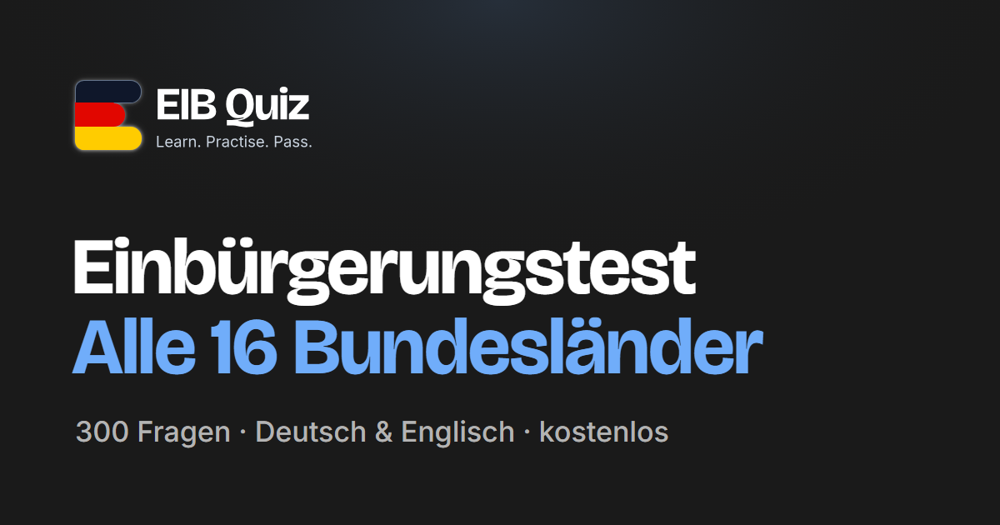

# EIB Quiz

**Purpose.** Help people practise for Germany's citizenship test, with German questions,
translations for learning, and short review sessions that revisit weaker answers.

**Summary.**

- Practise 300 general questions and 10 questions for each of the 16 federal states.
- Choose an exam simulation, topic or state practice, the full catalogue, or Smart Review.
- Keep progress on your device, with no account needed; install the app for offline practice.
- Read the translation limitations below before relying on a translated explanation.

**[Try the quiz](https://palasuhas.github.io/eib-quiz/)** ·
[Source](https://github.com/palasuhas/eib-quiz) · [Built by Suhas Pala](https://suhaspala.com)



## What to try

Pick your federal state, then open Practise. An exam simulation draws 30 general questions
and 3 state questions, with a 60-minute timer and a pass mark of 17. Topic practice and
Smart Review provide shorter ways to learn. These are practice results, not an official
exam result or a guarantee of passing.

German question wording remains visible while translations support learning. English and
German are built in. Ten additional language files are available: Arabic, Turkish, Russian,
Persian, Ukrainian, Albanian, Bosnian, Romanian, Kurdish (Kurmanji), and Polish.

## Sources and limitations

This is an independent learning project, not an official BAMF service. The question bank is
based on BAMF's *Leben in Deutschland* catalogue. The repository includes the
[catalogue PDF](img/gesamtfragenkatalog-lebenindeutschland.pdf), the
[structured source](tools/data/official-catalogue-bamf-2026-02.json), and
[image credits](img/ATTRIBUTIONS.md).

The ten additional translations were released without native-speaker review at the owner's
request. Automated checks and AI audits do not replace that review. The
[language review record](i18n/README.md) lists the known limitations and review status.
Consult the official catalogue for authoritative wording.

Progress is stored in this browser, not synced between devices. Clearing browser data can
remove it. Offline practice depends on a successful first online load and the assets cached
on that device. Fonts and optional feedback use external services.

## Run locally

Serve the folder over HTTP so the app can fetch its question and language files. There are
no npm dependencies or build step. With Python installed:

```sh
python -m http.server 8766 --bind 127.0.0.1
```

Open <http://127.0.0.1:8766/>. Production is served from `main` at the repository root through
GitHub Pages. A Pages deployment must succeed before a new commit is considered published.

## Check a change

With Node.js 24 or newer, run the same checks used by CI, plus the inline-script check:

```sh
node --test tools/*.test.mjs
node tools/validate.js
node tools/check-inline-js.js
node --check sw.js
```

These check question structure and image paths, translation completeness, colour contrast,
size rules, and JavaScript syntax. They do not establish translation accuracy or replace
testing a real session, keyboard navigation, offline behavior, and mobile layout in a browser.

## Project notes

The app is plain HTML, CSS and JavaScript. `index.html` holds the interface, `questions.json`
holds the question bank, `i18n/` holds additional translations, and `sw.js` handles offline
caching. [Current work](docs/TODO.md), [language reviews](i18n/README.md), and
[contributor instructions](AGENTS.md) explain the remaining work and design decisions.

No new reuse license is granted by this readiness update. Third-party questions, images,
fonts and other assets retain their own terms; see the attribution files before reusing them.
